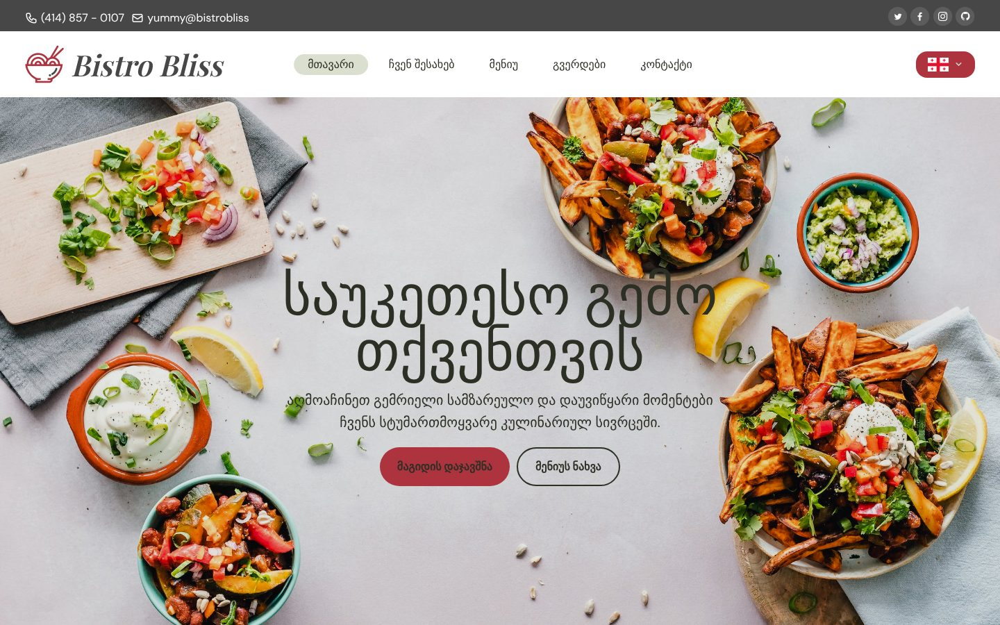
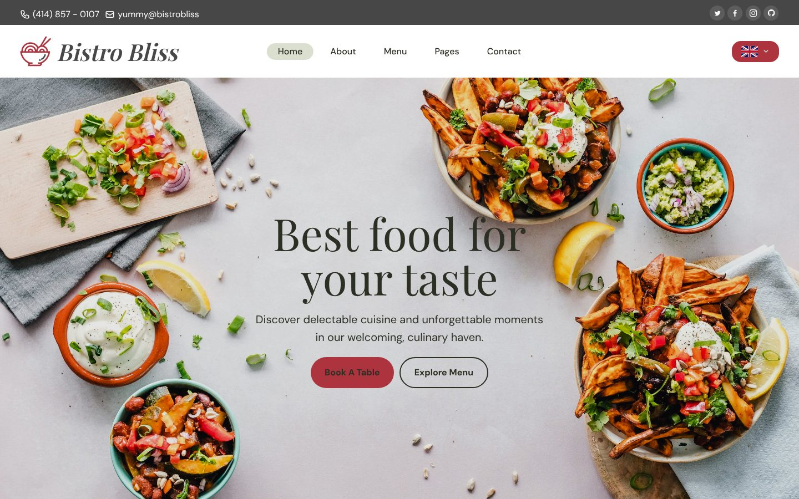
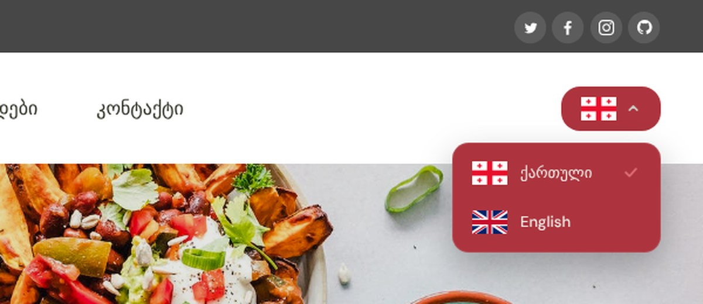
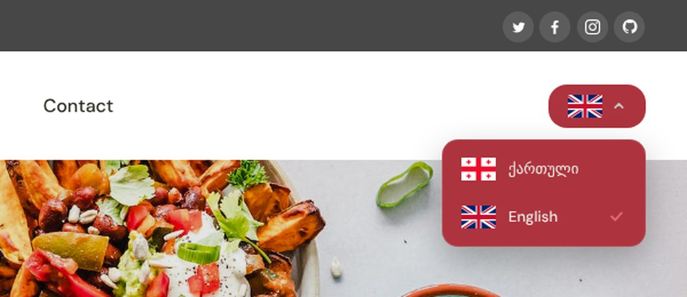
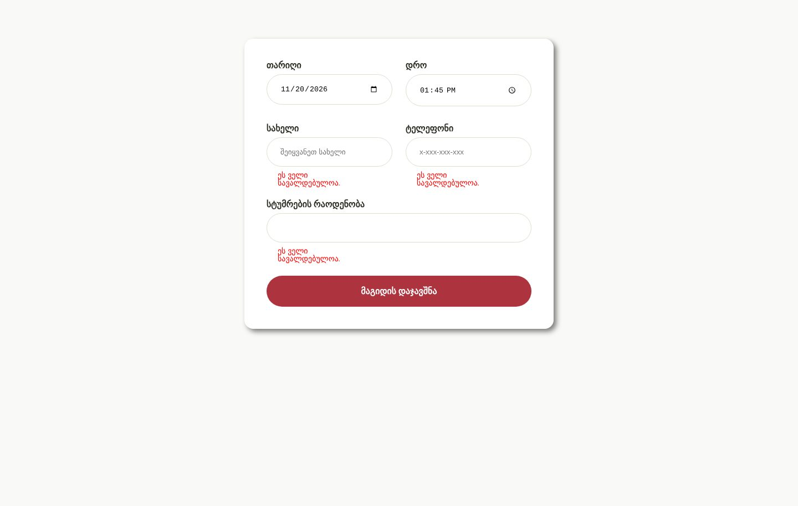
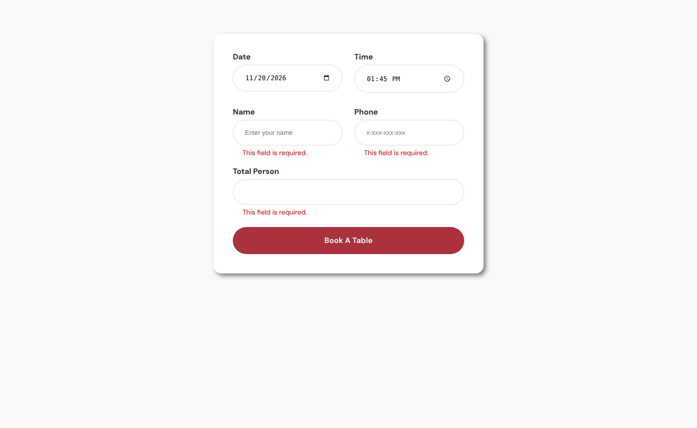
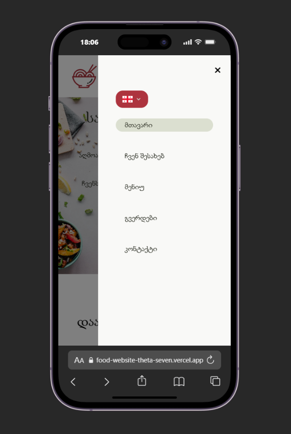
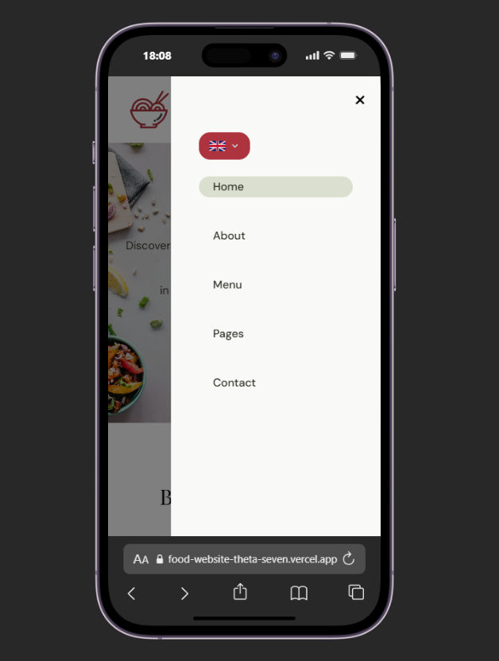
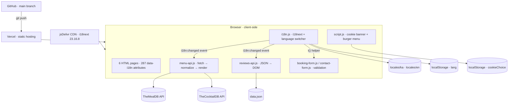

# Bistro Bliss — Bilingual Restaurant Website (Georgian / English)

[](https://food-website-theta-seven.vercel.app/)


-lightgrey>)


**Bistro Bliss** is a responsive, **bilingual (Georgian 🇬🇪 / English 🇬🇧) multi-page restaurant website** built with **HTML5, CSS3 and Vanilla JavaScript**, with no UI framework, no bundler and no build step. It turns a **Figma design** into a production website with a **dynamic menu powered by two REST APIs**, **client-side internationalization (i18n) with i18next**, **custom form validation**, a **responsive mobile navigation drawer** and **persistent user preferences in `localStorage`**.

🔗 **Live:** [food-website-theta-seven.vercel.app](https://food-website-theta-seven.vercel.app/)



---

## Table of Contents

- [The Story: From Personal Project to Bilingual University Project](#the-story-from-personal-project-to-bilingual-university-project)
- [Features](#features)
- [Screenshots](#screenshots)
- [Tech Stack](#tech-stack)
- [Architecture](#architecture)
- [Internationalization (i18n) Deep Dive](#internationalization-i18n-deep-dive)
- [Dynamic Menu & API Integration](#dynamic-menu--api-integration)
- [Form Validation](#form-validation)
- [Project Structure](#project-structure)
- [Getting Started](#getting-started)
- [Deployment](#deployment)
- [Testing](#testing)
- [Accessibility & Performance](#accessibility--performance)
- [Roadmap](#roadmap)
- [Author](#author)

---

## The Story: From Personal Project to Bilingual University Project

Bistro Bliss started as a **personal project** to practise turning a real Figma design into a responsive website with plain HTML, CSS and JavaScript. It was built as an English-only site and covered the full front-end workflow: semantic markup, responsive layouts, DOM manipulation, asynchronous API calls and form validation.

Later, I chose it as my **university final project (production practice)** to complete the semester. My lecturer asked for the website to be available **in Georgian**.

The quick option was to translate the hard-coded text and drop English. I didn't do that. Instead I **changed the architecture** so the site supports **both languages from one codebase**:

- I evaluated approaches (duplicate HTML pages per language, a hand-made translation object, or a standard i18n library) and chose **[i18next](https://www.i18next.com/)**, the industry-standard JavaScript i18n framework also used by `react-i18next` and `next-i18next`.
- All UI text moved out of the markup into **JSON locale files** (`locales/ka`, `locales/en`), with **129 keys** in each language.
- HTML elements became **declarative translation targets** through `data-i18n` attributes (**287 elements across 6 pages**).
- Dynamic content (API menu, reviews, validation errors) now **re-renders in the new language on an event**, without reloading the page or calling the API again.
- A keyboard-accessible **KA/EN language switcher** with flags was added to the header and the mobile sidebar.
- Georgian is the **default language**, English is the **fallback**, and the visitor's choice is **remembered**.

The result: the site gained a second language **without losing the original English version**, and adding a third language now takes **one JSON file and one line of code**.

---

## Features

- **Bilingual UI (Georgian / English)**: i18next-powered internationalization, instant language switching without page reload, saved preference, translated ARIA labels and placeholders.
- **Dynamic menu (REST API integration)**: meals from [TheMealDB](https://www.themealdb.com/) and cocktails from [TheCocktailDB](https://www.thecocktaildb.com/), with category filtering (All, Breakfast, Main Dishes, Drinks, Desserts).
- **Deep linking**: `menu.html?category=Drinks` opens the menu already filtered, through `URLSearchParams`.
- **Table booking form**: date, time, name, phone and guests, with real-time input masking and custom validation (working hours, no past dates, 1–10 guests).
- **Contact form**: name, email and subject validation with Regex.
- **Customer reviews**: loaded from local JSON (`data.json`) and translated through locale keys.
- **Responsive design**: Desktop-First, six breakpoints (1440 / 1200 / 1024 / 768 / 480 / 390 px), Flexbox + CSS Grid.
- **Mobile navigation drawer**: hamburger menu, sidebar with overlay, closes on overlay click, close button or outside click.
- **Cookie consent banner**: Accept/Reject choice saved in `localStorage`.
- **Loading, error and empty states**: clear UI feedback for every API request.
- **Performance**: lazy-loaded images, parallel requests with `Promise.all`, font `preconnect`, inline SVG sprite for icons and flags.

---

## Screenshots

| Georgian (default)                                                | English                                                          |
| ----------------------------------------------------------------- | ---------------------------------------------------------------- |
|                   |                   |
|  |  |
|  |  |
|               |               |

---

## Tech Stack

| Layer                | Technology                                                                                                                             |
| -------------------- | -------------------------------------------------------------------------------------------------------------------------------------- |
| Markup               | **HTML5**: semantic elements, `data-*` attributes, inline **SVG sprite** (`<symbol>` + `<use>`)                                        |
| Styling              | **CSS3**: Flexbox, CSS Grid, Media Queries, transitions, `prefers-reduced-motion`, Eric Meyer CSS Reset                                |
| Logic                | **Vanilla JavaScript (ES2020+)**: `async/await`, Fetch API, `Promise.all`, Optional Chaining, Spread, `CustomEvent`, `URLSearchParams` |
| Internationalization | **i18next 23.16.8** (UMD build via jsDelivr CDN), JSON locale files                                                                    |
| Data                 | **TheMealDB API**, **TheCocktailDB API**, local `data.json`                                                                            |
| Storage              | **Web Storage API** (`localStorage`): `lang`, `cookieChoice`                                                                           |
| Fonts                | Google Fonts: **Playfair Display** (headings), **DM Sans** (body)                                                                      |
| Design               | **Figma**                                                                                                                              |
| Version control      | **Git + GitHub**, Conventional Commits (`feat`, `refactor`, `style`, `docs`)                                                           |
| Hosting / CI/CD      | **Vercel** static hosting, automatic deploy on push to `main`                                                                          |

**Why Vanilla JavaScript?** For a site of this size (6 pages, 7 scripts), a framework would add complexity and bundle size without real benefit. Building without one shows command of the fundamentals: direct DOM control, event handling, asynchronous programming and state management.

---

## Architecture

All logic runs **client-side in the browser**. Vercel serves static files only, and the server is stateless. The code follows **Separation of Concerns** (structure in HTML, presentation in CSS, behaviour in JS) and the **Single Responsibility Principle**, with one script per feature.



**Key design decisions**

- **Event-driven, loosely coupled modules (Publish–Subscribe).** `i18n.js` doesn't know which modules depend on it. After translating the page it dispatches an `i18n:changed` `CustomEvent`, and `menu-api.js` and `reviews-api.js` subscribe and re-render themselves. A new dynamic component needs no change in `i18n.js` (Open/Closed Principle).
- **Data separated from presentation.** API responses are normalized into one shape, and translated fallback text is chosen at render time. A language change therefore re-renders the cached data with no new network request.
- **Logic decoupled from visible text.** Menu buttons carry `data-category` (the logic ID) separately from `data-i18n` (the visible label), so translating a button can never break filtering or deep links.
- **Defensive programming.** Scripts check that their DOM containers exist, `localStorage` access is wrapped in `try/catch` (private mode, blocked storage), and every API call has an error state.
- **Fixed script order on every page:** `i18next (CDN) → i18n.js → script.js → page script`, so the global `t()` helper exists before any feature script uses it.

---

## Internationalization (i18n) Deep Dive

### How it works

1. **Read the saved language.** `getSavedLang()` reads `localStorage.lang`, checks it against a whitelist (`SUPPORTED_LANGS = ["ka", "en"]`) and defaults to `ka`.
2. **Load translations in parallel.** `loadTranslations()` fetches both locale files with `Promise.all`, checks `res.ok`, and builds the i18next `resources` object with `Object.fromEntries`.
3. **Initialize i18next** with `fallbackLng: "en"`.
4. **Translate the DOM.** `translatePage()` walks four kinds of declarative attributes and dispatches `i18n:changed`.
5. **Switch language at runtime.** The switcher calls `setLang()`, which updates the flag, `aria-selected`, `<html lang>` and `localStorage`, then calls `i18next.changeLanguage()`. That fires `languageChanged` → `translatePage()` → `i18n:changed`, and dynamic modules re-render.

### Declarative translation attributes

```html
<h1 data-i18n="menu.title">Our Menu</h1>
<h1 data-i18n-html="home.hero.title">Best food for <br />your taste</h1>
<input
  data-i18n-placeholder="forms.placeholders.name"
  placeholder="Enter your name"
/>
<button data-i18n-aria-label="common.lang.change" aria-label="Change language">
  …
</button>
<button data-category="Drinks" data-i18n="common.categories.drinks">
  Drinks
</button>
```

| Attribute               | Writes to            | Used for                       |
| ----------------------- | -------------------- | ------------------------------ |
| `data-i18n`             | `textContent` (safe) | Almost all text (287 elements) |
| `data-i18n-html`        | `innerHTML`          | Text that contains `<br />`    |
| `data-i18n-placeholder` | `placeholder`        | Form fields                    |
| `data-i18n-aria-label`  | `aria-label`         | Screen-reader labels           |

The English text stays in the HTML as a **built-in fallback**.

### The `t()` helper and graceful degradation

```js
window.t = function (key, fallback = "") {
  if (window.i18next?.isInitialized && window.i18next.exists(key)) {
    return window.i18next.t(key);
  }
  return fallback;
};
```

Every piece of dynamic text (menu states, validation errors, reviews) goes through `t(key, englishFallback)`. If the CDN is blocked, translations are still loading, or a key is missing, the site keeps working in English instead of breaking.

### Locale file structure

Both files share the same structure: **129 keys** grouped into **9 namespaces** (`common`, `home`, `about`, `blog`, `booking`, `contact`, `forms`, `menu`, `reviews`), using dot notation such as `common.nav.home` or `forms.errors.required`. Reviews are translated by record ID (`reviews.1.headline`) and fall back to the original `data.json` value.

### Adding a new language

1. Add `locales/<code>/translation.json` with the same keys.
2. Add the code to `SUPPORTED_LANGS` in `scripts/i18n.js`.
3. Add one `<li>` option with a flag to the language switcher.

---

## Dynamic Menu & API Integration

| UI category  | API           | Endpoint                                |
| ------------ | ------------- | --------------------------------------- |
| All (food)   | TheMealDB     | `/api/json/v1/1/search.php?s=`          |
| All (drinks) | TheCocktailDB | `/api/json/v1/1/filter.php?c=Cocktail`  |
| Breakfast    | TheMealDB     | `/api/json/v1/1/filter.php?c=Breakfast` |
| Main Dishes  | TheMealDB     | `/api/json/v1/1/filter.php?c=Chicken`   |
| Desserts     | TheMealDB     | `/api/json/v1/1/filter.php?c=Dessert`   |
| Drinks       | TheCocktailDB | `/api/json/v1/1/filter.php?c=Cocktail`  |

- **Fetch → Normalize → Render pipeline.** The two APIs return different shapes (`strMeal` / `strDrink`). An **adapter** (`normalizeMeal`, `normalizeDrink`) maps both to `{ id, name, thumb, description, price, type }`.
- **Strategy / lookup table.** A `CATEGORIES` object maps each category to its fetcher function instead of a long `if/else` chain.
- **Parallel requests.** The "All" view loads meals and drinks at the same time with `Promise.all` and mixes 6 + 6 items.
- **View state machine** (`loading` → `items` / `error`). The last state is cached, so a language switch re-renders in place without refetching.
- No API key is needed, so no secrets are exposed in client code.

---

## Form Validation

Both forms use one custom client-side validation pattern: `submit` → `preventDefault()` → clear errors → validate every field → `isValid` flag → success state. Native browser bubbles are turned off (`novalidate`) so errors look consistent and appear in the current language.

| Field  | Rule                                                                                                                            |
| ------ | ------------------------------------------------------------------------------------------------------------------------------- |
| Name   | Required, letters only, including **Georgian (`ა-ჰ`)**, Latin and Cyrillic: `/^[a-zA-Zა-ჰа-яА-ЯёЁ\s]+$/`, at least 2 characters |
| Phone  | `/^\+?[0-9]{9,12}$/`; input masking strips non-digits and auto-adds `+` for `995` (Georgian country code)                       |
| Email  | `/^[^\s@]+@[^\s@]+\.[^\s@]+$/`                                                                                                  |
| Date   | Defaults to today; past dates are blocked (`min` attribute + submit check)                                                      |
| Time   | Defaults to now; must be within working hours (10:00–00:00)                                                                     |
| Guests | 1–10 (larger groups are asked to contact the restaurant)                                                                        |

---

## Project Structure

```
Food-Website/
├── index.html                  # Home page
├── style.css                   # Global styles, language switcher, media queries
├── data.json                   # Customer reviews (source data)
├── locales/
│   ├── ka/translation.json     # Georgian — 129 keys
│   └── en/translation.json     # English — 129 keys
├── pages/
│   ├── about.html
│   ├── menu.html               # Dynamic API menu
│   ├── blog.html
│   ├── booking.html            # Table reservation + Google Maps
│   └── contact.html
├── scripts/
│   ├── i18n.js                 # i18next setup, page translation, t(), language switcher
│   ├── script.js               # Cookie banner, responsive navigation
│   ├── menu-api.js             # Fetch, normalize, render, filter, deep linking
│   ├── reviews-api.js          # Reviews + translation
│   ├── booking-form.js         # Booking validation + input masking
│   └── contact-form.js         # Contact validation
├── styles/                     # reset, header, footer, page-specific CSS
└── images/
```

---

## Getting Started

```bash
git clone https://github.com/Lanssii/Food-Website.git
cd Food-Website
npx serve .            # or VS Code → "Open with Live Server"
```

> ⚠️ Run the site through a **local HTTP server**. Opening `index.html` directly (`file://`) makes the browser block `fetch()`, so translations and reviews won't load and the site stays on its English fallback.

---

## Deployment

The site is deployed on **Vercel** with **Continuous Deployment**: every push to `main` triggers a new production deploy. There is no build step (Framework Preset: _Other_), and files are served over HTTPS from Vercel's edge CDN.

---

## Testing

The site is tested manually (black-box) with Chrome DevTools: device toolbar, network throttling and offline mode, and the Local Storage inspector. **24 test cases** cover:

- Menu loading, filtering, deep links, invalid parameters and the API error state.
- Booking and contact validation, including Georgian names.
- Cookie consent persistence, burger menu open/close and responsiveness at 6 breakpoints.
- **i18n:** default language, instant switching, persistence across pages, menu re-render on language change, Escape-key closing and **CDN-blocked fallback to English**.

---

## Accessibility & Performance

- **WAI-ARIA Listbox pattern** for the language switcher (`aria-haspopup`, `aria-expanded`, `role="listbox"`, `role="option"`, `aria-selected`).
- **Keyboard support:** Escape closes the menu and focus returns to the trigger; `:focus-visible` styles.
- **`<html lang>`** updates with the active language for correct screen-reader pronunciation.
- **`prefers-reduced-motion`** turns off switcher animations.
- **Semantic HTML5** landmarks (`nav`, `header`, `main`, `section`, `footer`).
- **Lazy loading**, `preconnect`, parallel fetches, and an SVG sprite instead of extra image requests.

---

## Roadmap

- [x] Multi-language support (Georgian / English) with i18next
- [ ] Back-end for bookings and messages (Node.js + Express or Firebase/Supabase)
- [ ] Server-side rendering or per-language URLs (`/ka/`, `/en/`) with `hreflang` for multilingual SEO
- [ ] Localized currency and dates with `Intl.NumberFormat` / `Intl.DateTimeFormat`
- [ ] Subresource Integrity (SRI) for CDN scripts
- [ ] Shared validators as ES Modules
- [ ] Automated tests (Jest, Playwright) and GitHub Actions CI
- [ ] Migration path to React / Next.js with `next-i18next` (the locale JSON files can be reused as they are)

---

## Author

**Lana Shotashvili**, IT student and front-end developer.
Personal project, later extended into a **university production practice (final) project** at Georgian Technical University.

- GitHub: [@Lanssii](https://github.com/Lanssii)
- Live demo: [food-website-theta-seven.vercel.app](https://food-website-theta-seven.vercel.app/)

<details>
<summary><b>Keywords</b></summary>

restaurant website, bilingual website, Georgian English website, i18n, i18next, internationalization, localization, l10n, language switcher, vanilla JavaScript, no framework, HTML5, CSS3, ES6, responsive design, mobile navigation drawer, CSS Grid, Flexbox, Fetch API, REST API integration, TheMealDB, TheCocktailDB, async/await, Promise.all, CustomEvent, event-driven architecture, form validation, regex validation, input masking, localStorage, cookie consent, deep linking, URLSearchParams, accessibility, WAI-ARIA, Figma to code, Vercel deployment, front-end portfolio project, university project

</details>
